<!-- The images on this page are generated. See scripts/README.md. -->

  <picture><source media="(prefers-color-scheme: dark)" srcset="./assets/hero-dark.svg"><source media="(prefers-color-scheme: light)" srcset="./assets/hero-light.svg"></picture>

  <a href="https://ritvikdayal.github.io/"><picture><source media="(prefers-color-scheme: dark)" srcset="./assets/link-portfolio-dark.svg"><source media="(prefers-color-scheme: light)" srcset="./assets/link-portfolio-light.svg"></picture></a>
  <a href="https://linkedin.com/in/ritvikdayal"><picture><source media="(prefers-color-scheme: dark)" srcset="./assets/link-linkedin-dark.svg"><source media="(prefers-color-scheme: light)" srcset="./assets/link-linkedin-light.svg"></picture></a>
  <a href="https://twitter.com/ritvikr98"><picture><source media="(prefers-color-scheme: dark)" srcset="./assets/link-x-dark.svg"><source media="(prefers-color-scheme: light)" srcset="./assets/link-x-light.svg"></picture></a>

 

  <picture><source media="(prefers-color-scheme: dark)" srcset="./assets/head-who-dark.svg"><source media="(prefers-color-scheme: light)" srcset="./assets/head-who-light.svg"></picture>

Senior software engineer, five-plus years on AI platforms, distributed backends and cloud infrastructure. I've proposed, won buy-in for, and shipped two production platforms end to end: an AI incident-investigation system and a browser-based BIM authoring platform. I tend to be the one who turns a manual process into something that runs itself.

Based in Noida, working remote with teams in the US. I cut cloud costs, harden systems for SOC 2, and mentor engineers across a six-hour time gap.

  <picture><source media="(prefers-color-scheme: dark)" srcset="./assets/stats-1-dark.svg"><source media="(prefers-color-scheme: light)" srcset="./assets/stats-1-light.svg">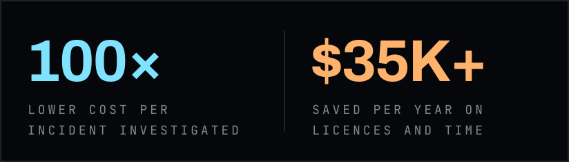</picture><picture><source media="(prefers-color-scheme: dark)" srcset="./assets/stats-2-dark.svg"><source media="(prefers-color-scheme: light)" srcset="./assets/stats-2-light.svg">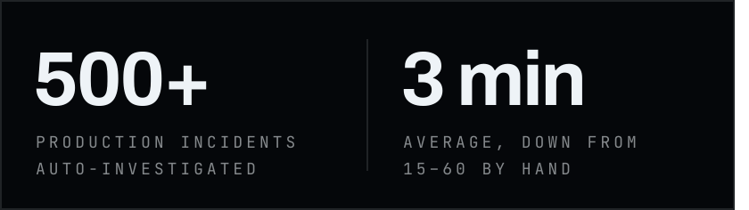</picture>

 

  <picture><source media="(prefers-color-scheme: dark)" srcset="./assets/head-work-dark.svg"><source media="(prefers-color-scheme: light)" srcset="./assets/head-work-light.svg"></picture>

  <picture><source media="(prefers-color-scheme: dark)" srcset="./assets/work-incidents-dark.svg"><source media="(prefers-color-scheme: light)" srcset="./assets/work-incidents-light.svg">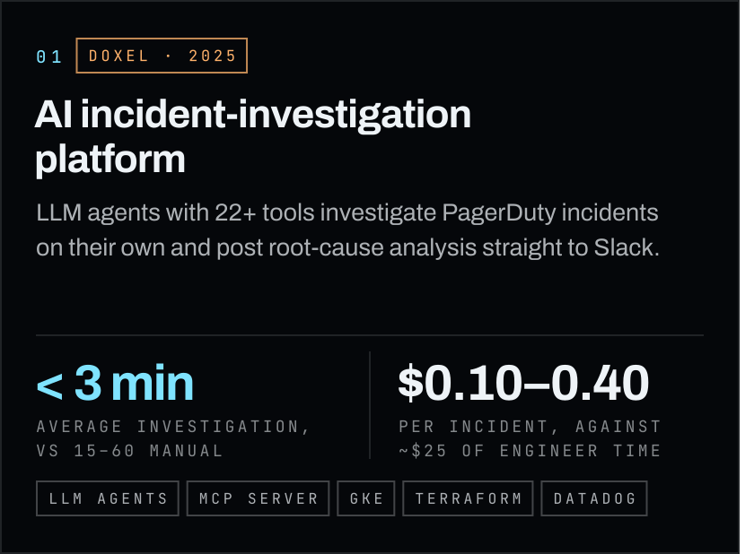</picture><picture><source media="(prefers-color-scheme: dark)" srcset="./assets/work-bim-dark.svg"><source media="(prefers-color-scheme: light)" srcset="./assets/work-bim-light.svg">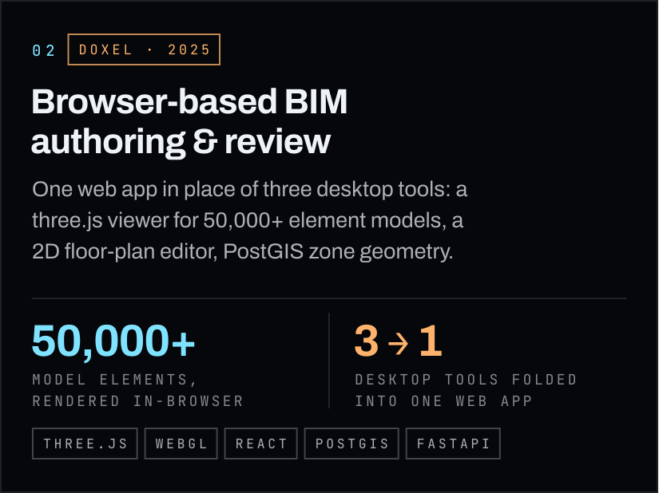</picture>
  <picture><source media="(prefers-color-scheme: dark)" srcset="./assets/work-unglamorous-dark.svg"><source media="(prefers-color-scheme: light)" srcset="./assets/work-unglamorous-light.svg">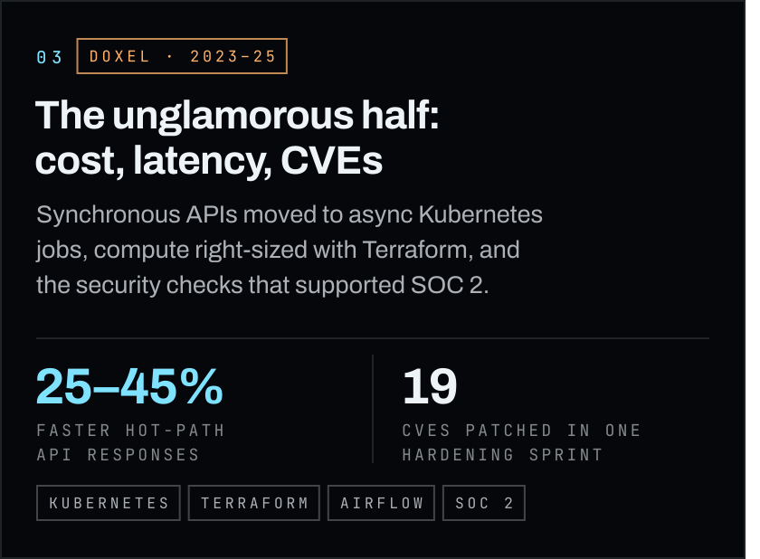</picture><picture><source media="(prefers-color-scheme: dark)" srcset="./assets/work-sandbox-dark.svg"><source media="(prefers-color-scheme: light)" srcset="./assets/work-sandbox-light.svg">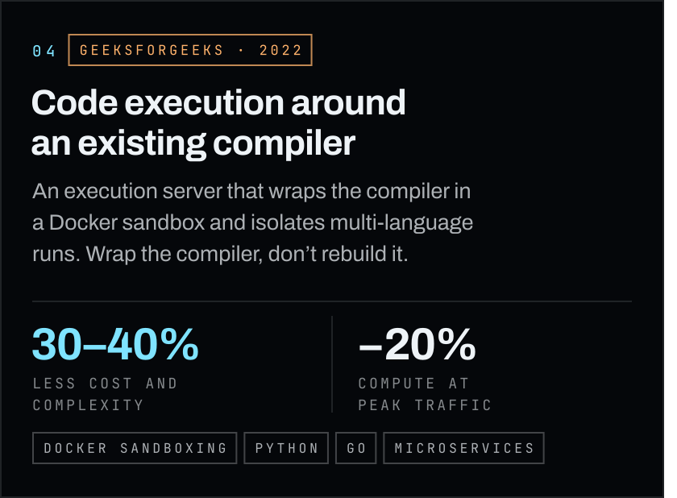</picture>

The full write-ups, with the numbers behind them, are on [ritvikdayal.github.io](https://ritvikdayal.github.io/#work).

 

  <picture><source media="(prefers-color-scheme: dark)" srcset="./assets/head-source-dark.svg"><source media="(prefers-color-scheme: light)" srcset="./assets/head-source-light.svg"></picture>

  <a href="https://github.com/RitvikDayal/featherwall"><picture><source media="(prefers-color-scheme: dark)" srcset="./assets/source-featherwall-dark.svg"><source media="(prefers-color-scheme: light)" srcset="./assets/source-featherwall-light.svg">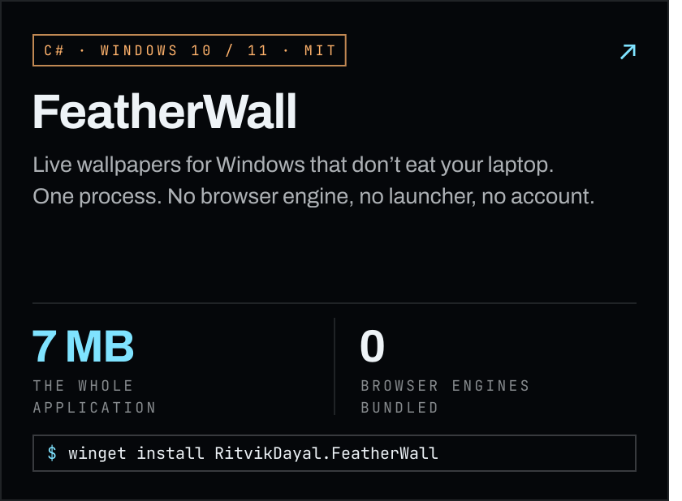</picture></a><a href="https://github.com/RitvikDayal/whetstone"><picture><source media="(prefers-color-scheme: dark)" srcset="./assets/source-whetstone-dark.svg"><source media="(prefers-color-scheme: light)" srcset="./assets/source-whetstone-light.svg">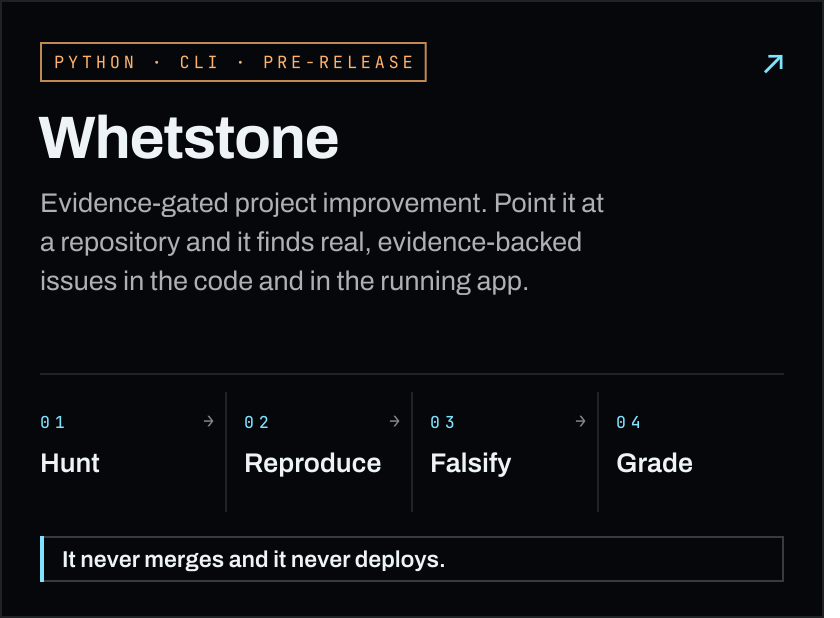</picture></a>

Also [paginate-fastapi](https://github.com/RitvikDayal/paginate-fastapi), a small pagination library for FastAPI, on PyPI.

 

  <picture><source media="(prefers-color-scheme: dark)" srcset="./assets/head-stack-dark.svg"><source media="(prefers-color-scheme: light)" srcset="./assets/head-stack-light.svg"></picture>

  <picture><source media="(prefers-color-scheme: dark)" srcset="./assets/stack-ai-dark.svg"><source media="(prefers-color-scheme: light)" srcset="./assets/stack-ai-light.svg">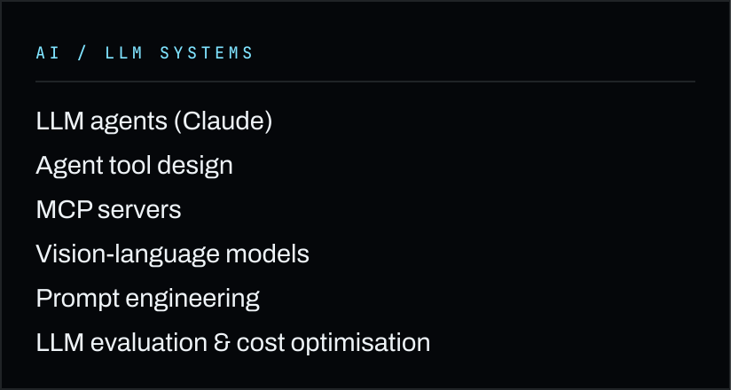</picture><picture><source media="(prefers-color-scheme: dark)" srcset="./assets/stack-cloud-dark.svg"><source media="(prefers-color-scheme: light)" srcset="./assets/stack-cloud-light.svg">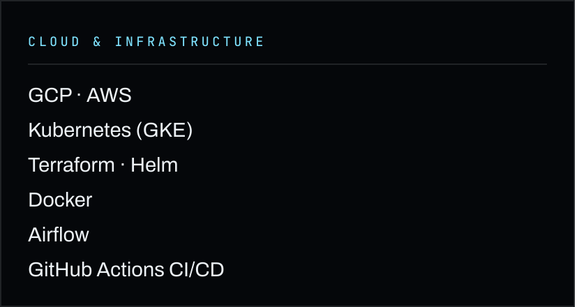</picture>
  <picture><source media="(prefers-color-scheme: dark)" srcset="./assets/stack-backend-dark.svg"><source media="(prefers-color-scheme: light)" srcset="./assets/stack-backend-light.svg">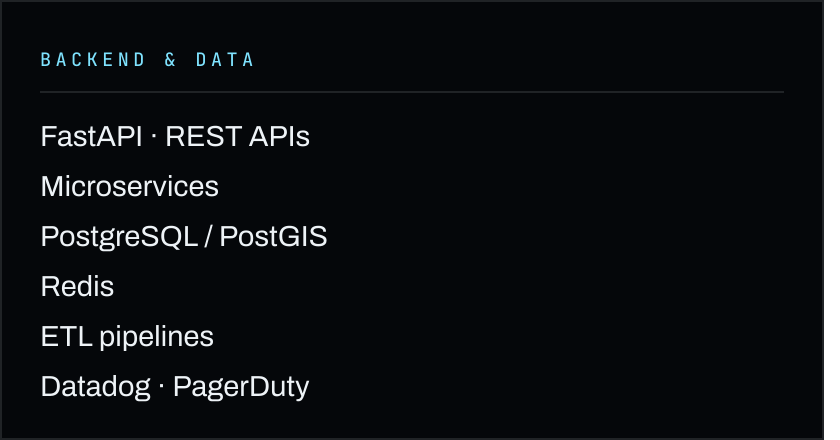</picture><picture><source media="(prefers-color-scheme: dark)" srcset="./assets/stack-lang-dark.svg"><source media="(prefers-color-scheme: light)" srcset="./assets/stack-lang-light.svg">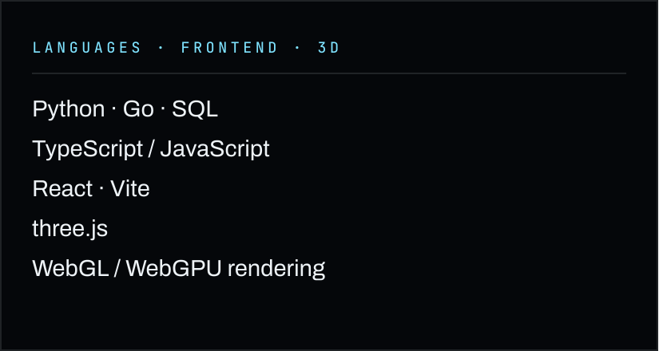</picture>
  <picture><source media="(prefers-color-scheme: dark)" srcset="./assets/recognition-award-dark.svg"><source media="(prefers-color-scheme: light)" srcset="./assets/recognition-award-light.svg">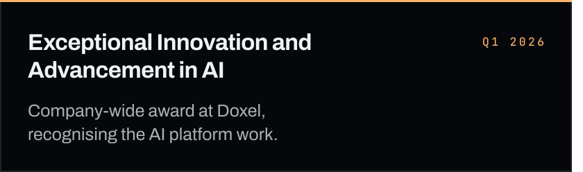</picture><picture><source media="(prefers-color-scheme: dark)" srcset="./assets/recognition-sih-dark.svg"><source media="(prefers-color-scheme: light)" srcset="./assets/recognition-sih-light.svg">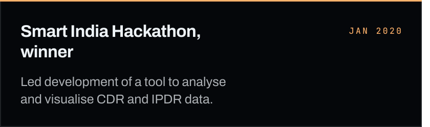</picture>

 

  <picture><source media="(prefers-color-scheme: dark)" srcset="./assets/head-signal-dark.svg"><source media="(prefers-color-scheme: light)" srcset="./assets/head-signal-light.svg"></picture>

Most of the work above lives in private repositories. This is the public part, redrawn twice a day by a workflow in this repository.

<!-- signal-cards:start -->

  <picture><source media="(prefers-color-scheme: dark)" srcset="https://raw.githubusercontent.com/RitvikDayal/ritvikdayal/output/signal-activity-dark.svg"><source media="(prefers-color-scheme: light)" srcset="https://raw.githubusercontent.com/RitvikDayal/ritvikdayal/output/signal-activity-light.svg">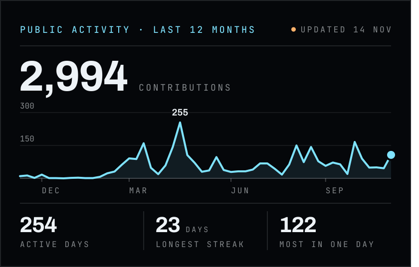</picture><picture><source media="(prefers-color-scheme: dark)" srcset="https://raw.githubusercontent.com/RitvikDayal/ritvikdayal/output/signal-languages-dark.svg"><source media="(prefers-color-scheme: light)" srcset="https://raw.githubusercontent.com/RitvikDayal/ritvikdayal/output/signal-languages-light.svg">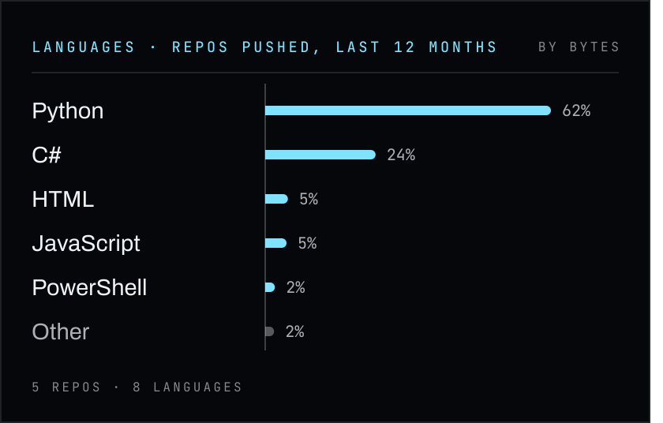</picture>

<!-- signal-cards:end -->

  <picture><source media="(prefers-color-scheme: dark)" srcset="https://raw.githubusercontent.com/RitvikDayal/ritvikdayal/output/github-contribution-grid-snake-dark.svg"><source media="(prefers-color-scheme: light)" srcset="https://raw.githubusercontent.com/RitvikDayal/ritvikdayal/output/github-contribution-grid-snake.svg"></picture>

 

  <picture><source media="(prefers-color-scheme: dark)" srcset="./assets/footer-dark.svg"><source media="(prefers-color-scheme: light)" srcset="./assets/footer-light.svg"></picture>

  <a href="https://ritvikdayal.github.io/#contact"><picture><source media="(prefers-color-scheme: dark)" srcset="./assets/link-portfolio-dark.svg"><source media="(prefers-color-scheme: light)" srcset="./assets/link-portfolio-light.svg"></picture></a>
  <a href="https://linkedin.com/in/ritvikdayal"><picture><source media="(prefers-color-scheme: dark)" srcset="./assets/link-linkedin-dark.svg"><source media="(prefers-color-scheme: light)" srcset="./assets/link-linkedin-light.svg"></picture></a>
  

